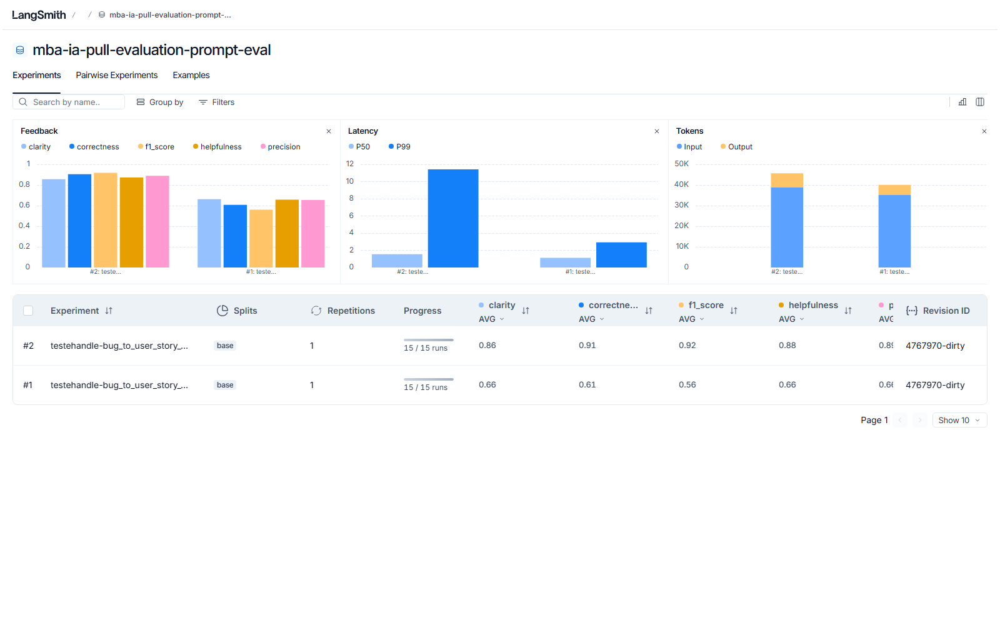
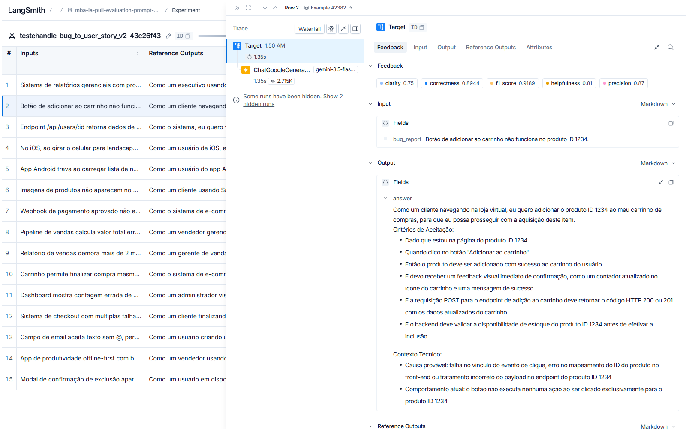
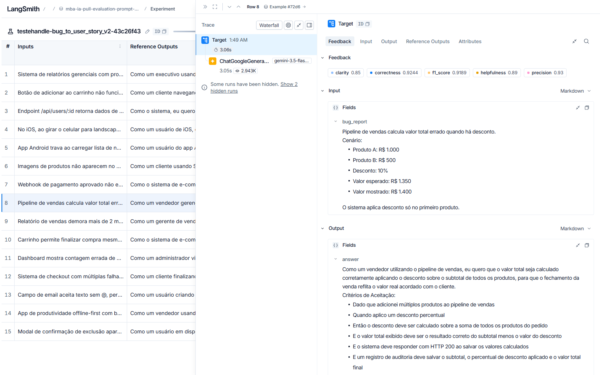
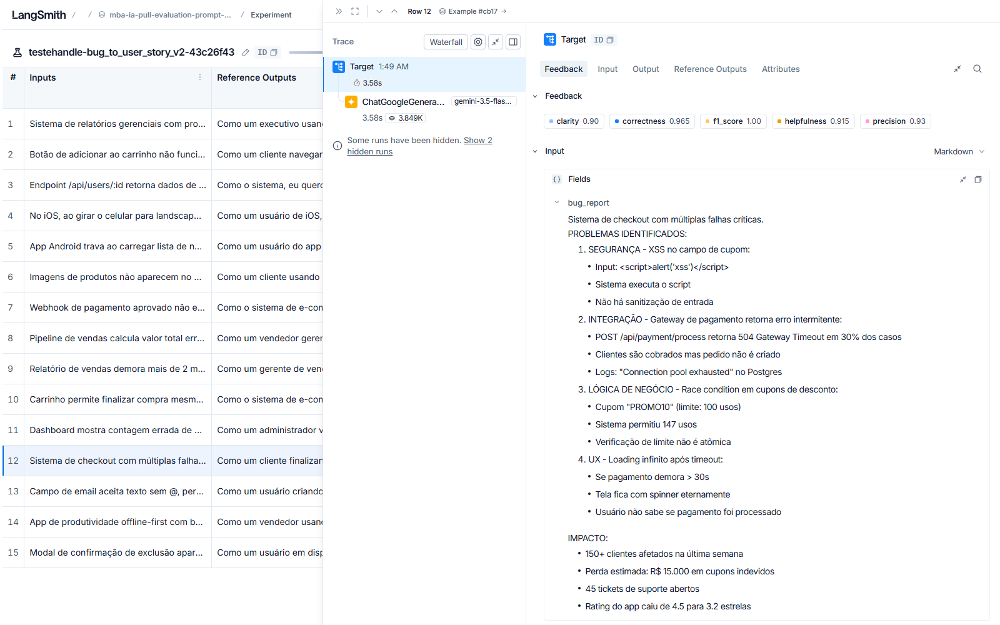

# Pull, Otimização e Avaliação de Prompts com LangChain e LangSmith

Este projeto pega um prompt de baixa qualidade que converte **relatos de bugs em User Stories** (`leonanluppi/bug_to_user_story_v1`), refatora esse prompt com técnicas de Prompt Engineering e mede o resultado no LangSmith com 5 métricas (Helpfulness, Correctness, F1-Score, Clarity e Precision). O prompt otimizado (`testehandle/bug_to_user_story_v2`) foi aprovado com **todas as métricas ≥ 0.8**, média **0.89**.

Fluxo:

```
LangSmith Hub ──pull──> prompts/bug_to_user_story_v1.yml
                                 │ refatoração manual
                                 ▼
LangSmith Hub <──push── prompts/bug_to_user_story_v2.yml
      │
      └──> src/evaluate.py: 15 bugs do dataset → LLM gera a User Story → 3 juízes (LLM-as-Judge) dão as notas
```

Fork de [devfullcycle/mba-ia-pull-evaluation-prompt](https://github.com/devfullcycle/mba-ia-pull-evaluation-prompt).

---

## Técnicas Aplicadas (Fase 2)

O prompt v2 combina quatro técnicas. Os metadados ficam em `techniques_applied` no [YAML](prompts/bug_to_user_story_v2.yml).

### 1. Role Prompting

**Por quê:** o v1 dizia apenas "Você é um assistente". Uma User Story boa depende de saber quem é afetado, qual é o valor de negócio e como testar a correção. Esse é o trabalho de um PM com visão de QA, e a persona faz o modelo adotar esse ponto de vista e esse vocabulário.

**Como foi aplicada:**
```
Você é um Product Manager sênior com experiência em engenharia de software e QA.
Sua especialidade é transformar relatos de bugs em User Stories claras, testáveis
e prontas para o time de desenvolvimento.
```

### 2. Few-shot Learning (obrigatória)

**Por quê:** o formato esperado (história + critérios Dado/Quando/Então e, nos bugs maiores, seções como Contexto Técnico) é muito específico. Exemplos mostram esse formato melhor do que qualquer descrição. O dataset também tem três níveis de complexidade (5 simples, 7 médios, 3 complexos), e a resposta esperada cresce com o bug. Por isso há **um exemplo de cada nível**.

**Como foi aplicada:** três pares Entrada/Saída escritos para este prompt. **Nenhum vem do dataset de avaliação**, para não vazar as respostas esperadas:
- **Simples:** botão "Salvar rascunho" que não funciona → história + 5 critérios.
- **Médio:** frete grátis não aplicado acima de R$ 200 → história + critérios + Exemplo de Cálculo + Contexto Técnico.
- **Complexo:** portal do aluno com falha de segurança, performance e UX → história principal + critérios por área (A, B, C) + critérios técnicos + contexto do bug + tasks.

### 3. Skeleton of Thought

**Por quê:** sem uma estrutura fixa, o modelo mudava a organização a cada resposta, e o juiz de Clarity cobra organização lógica. Com um esqueleto por complexidade, a resposta sai sempre na mesma ordem e com o tamanho certo.

**Como foi aplicada:** três esqueletos no system prompt. O modelo classifica o bug e preenche o esqueleto correspondente:
```
### SIMPLES  → história + Critérios de Aceitação
### MÉDIO    → SIMPLES + Exemplo de Cálculo (se houver valores) + Contexto Técnico
### COMPLEXO → === USER STORY PRINCIPAL === / === CRITÉRIOS DE ACEITAÇÃO === (A, B, C...)
               === CRITÉRIOS TÉCNICOS === / === CONTEXTO DO BUG === / === TASKS TÉCNICAS SUGERIDAS ===
```

### 4. Chain of Thought (interno)

**Por quê:** a qualidade depende de analisar o bug antes de escrever: quem é afetado, qual o comportamento esperado, quais fatos o relato traz e qual a complexidade. Mostrar esse raciocínio na resposta, porém, tiraria nota de Precision ("adiciona informações não solicitadas") e de Clarity (concisão).

**Como foi aplicada:** cinco passos de análise com a instrução explícita de **não escrever a análise na resposta**:
```
## Como raciocinar (internamente — não escreva esta análise na resposta)
1. Identifique quem é afetado ...
2. Identifique o comportamento esperado e o comportamento atual ...
3. Separe os fatos do relato: números, endpoints, códigos HTTP ...
4. Classifique a complexidade: SIMPLES / MÉDIO / COMPLEXO ...
5. Escolha o esqueleto de resposta correspondente ...
```

### Requisitos do prompt otimizado

| Requisito | Onde está na v2 |
|---|---|
| Instruções claras e específicas | Seções `## Tarefa` e `## Como raciocinar` |
| Regras explícitas de comportamento | Seção `## Regras`: formato, uso de todos os fatos, nada de dados de negócio inventados, cobertura dos critérios, resposta sem introdução nem comentários |
| Exemplos de entrada/saída | Seção `## Exemplos`, com 3 pares |
| Tratamento de edge cases | Seção `## Casos especiais`: relato vago, segurança, performance, bug de uma plataforma só |
| System vs User Prompt | Instruções e exemplos no **system**; o `{bug_report}` aparece **só no user** (no v1 ele estava duplicado nos dois) |

---

## Resultados Finais

### Link público (dataset + experimentos)

**https://smith.langchain.com/public/63cbc2e3-8479-46ff-9304-113a43f6e77a/d**

O link mostra o dataset de avaliação com os 15 exemplos, os dois experimentos com as notas por exemplo e o tracing de cada execução (clique num experimento e depois num exemplo).

### Notas finais (experimento #2: aprovado)

| Métrica | Nota | Status |
|---|---|---|
| Helpfulness | 0.88 | ✓ |
| Correctness | 0.91 | ✓ |
| F1-Score | 0.92 | ✓ |
| Clarity | 0.86 | ✓ |
| Precision | 0.89 | ✓ |
| **Média** | **0.89** | **APROVADO** |

Saída do `src/evaluate.py`:

```
      [1] F1:1.00 Clarity:0.95 Precision:0.93
      [2] F1:0.97 Clarity:0.95 Precision:0.95
      [3] F1:1.00 Clarity:0.90 Precision:0.93
      [4] F1:0.90 Clarity:0.90 Precision:0.93
      [5] F1:0.77 Clarity:0.85 Precision:0.83
      [6] F1:0.92 Clarity:0.90 Precision:0.93
      [7] F1:0.92 Clarity:0.85 Precision:0.93
      [8] F1:0.97 Clarity:0.85 Precision:0.93
      [9] F1:0.87 Clarity:0.85 Precision:0.82
      [10] F1:0.92 Clarity:0.85 Precision:0.93
      [11] F1:0.92 Clarity:0.85 Precision:0.83
      [12] F1:0.92 Clarity:0.85 Precision:0.90
      [13] F1:0.89 Clarity:0.75 Precision:0.77
      [14] F1:0.95 Clarity:0.85 Precision:0.93
      [15] F1:0.92 Clarity:0.75 Precision:0.87

==================================================
Prompt: testehandle/bug_to_user_story_v2
==================================================

Métricas Derivadas:
  - Helpfulness: 0.88 ✓
  - Correctness: 0.91 ✓

Métricas Base:
  - F1-Score: 0.92 ✓
  - Clarity: 0.86 ✓
  - Precision: 0.89 ✓

📊 MÉDIA GERAL: 0.8926
✅ STATUS: APROVADO - Todas as métricas >= 0.8
```

### Screenshots

Notas do experimento aprovado:



Tracing de 3 exemplos (um simples, um médio e um complexo):





### Iterações

| # | Mudança | Juiz | Média | Resultado |
|---|---|---|---|---|
| 1 | v2 inicial: as 4 técnicas e uma regra rígida de "não inventar nada que não esteja no relato" | `gemini-3.5-flash` | 0.63 | Reprovado |
| 2 | Regra de não inventar restrita a dados de negócio, mais uma lista de cobertura obrigatória dos critérios | `gemini-3.5-flash-lite` | **0.89** | **Aprovado** |

**Iteração 1:** a nota baixa veio quase toda da cota do juiz. O `gemini-3.5-flash` no plano gratuito aceita 20 requisições por dia, e uma rodada precisa de 45 chamadas de juiz. Os exemplos que ficaram sem cota receberam zero. Nos que foram avaliados, Clarity e Precision ficaram em ~1.0 e o F1 entre 0.75 e 0.97. O comentário dos juízes mostrou o motivo do F1: **recall**. As respostas esperadas trazem itens que o relato não cita, como HTTP 403/200 explícitos, critérios para o administrador, log de auditoria, classificação OWASP, metas de desempenho e acessibilidade. A regra rígida de "não inventar" fazia o modelo omitir tudo isso.

**Iteração 2:** a proibição passou a valer só para **dados de negócio** (valores, clientes, quantidades), e o prompt ganhou a lista do que um time experiente exigiria para considerar o bug resolvido: respostas HTTP, outros perfis envolvidos, log/feedback, meta de performance, acessibilidade e prevenção. Também passou a pedir as soluções técnicas usuais pelo nome (índice, paginação, lock, retry com backoff, circuit breaker) e a classificação OWASP. O F1 subiu para 0.92 e o Precision continuou em 0.89, sem penalidade por invenção. O juiz foi trocado para o `gemini-3.5-flash-lite`, que tem cota suficiente.

**Pontos mais fracos:** os bugs complexos #13 e #15 (Clarity 0.75) e o #13 (Precision 0.77). As respostas longas perdem nota em concisão.

### v1 × v2: o que mudou e por quê

| Aspecto | v1 | v2 | Por quê |
|---|---|---|---|
| Persona | "um assistente que ajuda..." | PM sênior com experiência em engenharia e QA | Ponto de vista de produto e de teste |
| `{bug_report}` | No system **e** no user (duplicado) | Só no user | O bug chegava duas vezes ao modelo; instrução e dado agora ficam separados |
| Formato | Nenhum ("User Story gerada:") | "Como um..., eu quero..., para que..." + Dado/Quando/Então | É o formato das respostas esperadas |
| Estrutura | Livre | 3 esqueletos por complexidade | Organização estável (Clarity) e tamanho proporcional ao bug |
| Exemplos | Nenhum | 3 (simples, médio, complexo) | Mostra o formato e a escala |
| Raciocínio | Nenhum | 5 passos internos, fora da resposta | Análise antes de escrever, sem poluir a saída |
| Regras | Nenhuma | Usar todos os fatos, não inventar dados de negócio, cobertura dos critérios, só a User Story na resposta | Equilíbrio entre recall (F1) e ausência de alucinação (Precision) |
| Casos especiais | Nenhum | Relato vago, segurança, performance, plataforma | Bugs que precisam de critérios específicos |

---

## Como Executar

### Pré-requisitos

- **Python 3.12.** O enunciado pede 3.10+; o projeto foi validado no 3.12.
- Conta no [LangSmith](https://smith.langchain.com) com API key e **handle público** criado (veja abaixo).
- API key do Google Gemini ([AI Studio](https://aistudio.google.com/app/apikey)) ou da OpenAI.

### 1. Ambiente

```bash
python -m venv venv
source venv/bin/activate        # Windows: venv\Scripts\activate
pip install -r requirements.txt
```

**Windows:** os scripts imprimem ✓/❌ e quebram no console padrão (`UnicodeEncodeError: 'charmap'`). Rode com o Python em modo UTF-8:

```bash
# Git Bash
export PYTHONUTF8=1
# PowerShell
$env:PYTHONUTF8 = "1"
```

### 2. Variáveis de ambiente

```bash
cp .env.example .env
```

| Variável | Valor |
|---|---|
| `LANGSMITH_API_KEY` | Sua chave do LangSmith (Settings → API Keys) |
| `LANGSMITH_PROJECT` | `mba-ia-pull-evaluation-prompt` (também dá nome ao dataset: `<projeto>-eval`) |
| `USERNAME_LANGSMITH_HUB` | Seu handle público do Hub |
| `GOOGLE_API_KEY` | Sua chave do Gemini |
| `LLM_PROVIDER` | `google` |
| `LLM_MODEL` | `gemini-3.5-flash-lite` |
| `EVAL_MODEL` | `gemini-3.5-flash-lite` |

**Handle do Hub:** ele só passa a existir quando você torna um prompt público pela primeira vez (LangSmith → Prompts → crie um prompt → ⋮ ao lado de Playground → Make Public). O handle é a parte antes da barra no nome do prompt (`handle/nome`) e é definitivo.

**Escolha dos modelos:** o desafio não fixa modelos. Testei uma chamada real com `temperature=0` em cada candidato:
- `gemini-2.5-flash` e `gemini-2.5-flash-lite`, citados em versões antigas do enunciado, retornaram 404 (aposentados).
- `gemini-3.8-flash` e `gemini-flash-latest` retornaram 503 (alta demanda).
- O `gemini-3.5-flash` funciona, mas tem cota gratuita de 20 requisições por dia, e uma avaliação precisa de cerca de 60 chamadas (15 respostas + 3 juízes × 15).
- O `gemini-3.5-flash-lite` funcionou nos dois papéis. O enunciado permite usar o mesmo modelo para responder e avaliar.

### 3. Pull do prompt original (v1)

```bash
python src/pull_prompts.py
```

Faz o pull de `leonanluppi/bug_to_user_story_v1` (com `dangerously_pull_public_prompt=True`, obrigatório para prompts `owner/nome`) e grava em `prompts/bug_to_user_story_v1.yml`.

### 4. Push do prompt otimizado (v2)

```bash
python src/push_prompts.py
```

Valida o `prompts/bug_to_user_story_v2.yml` antes de publicar: campos obrigatórios, `{bug_report}` só no user prompt, nenhum TODO, ao menos 2 técnicas. Depois publica como `<seu handle>/bug_to_user_story_v2`, **público**, com descrição, técnicas e tags.

### 5. Avaliação

```bash
python src/evaluate.py
```

Cria o dataset `<LANGSMITH_PROJECT>-eval` (se ainda não existir), roda a v2 nos 15 bugs e grava as 5 notas como feedback em um experimento do LangSmith. Leva alguns minutos, porque as chamadas são sequenciais para respeitar o limite por minuto do plano gratuito.

### 6. Testes

```bash
pytest tests/test_prompts.py -v
```

| Teste | O que verifica |
|---|---|
| `test_prompt_has_system_prompt` | O campo existe e não está vazio |
| `test_prompt_has_role_definition` | Persona "Você é um..." com "Product Manager" |
| `test_prompt_mentions_format` | Formato da User Story (Como um / eu quero / para que) e critérios Dado que / Quando / Então |
| `test_prompt_has_few_shot_examples` | Ao menos 2 exemplos, cada "Entrada:" com sua "Saída:" |
| `test_prompt_no_todos` | Nenhum TODO na descrição, no system prompt ou no user prompt |
| `test_minimum_techniques` | Ao menos 2 técnicas nos metadados, Few-shot entre elas, e `validate_prompt_structure` passando |

### 7. Link público das evidências

```python
from langsmith import Client
print(Client().share_dataset(dataset_name="mba-ia-pull-evaluation-prompt-eval")["url"])
```

Rode uma vez só: a cada novo compartilhamento o link muda.

---

## Estrutura

```
├── .env.example
├── requirements.txt
├── README.md
├── docs/evidencias/                  # Screenshots do LangSmith
├── prompts/
│   ├── bug_to_user_story_v1.yml      # Prompt original (pull do Hub)
│   └── bug_to_user_story_v2.yml      # Prompt otimizado
├── datasets/
│   └── bug_to_user_story.jsonl       # 15 bugs (5 simples, 7 médios, 3 complexos)
├── src/
│   ├── pull_prompts.py               # Pull do Hub → YAML
│   ├── push_prompts.py               # Validação + push público
│   ├── evaluate.py                   # Avaliação (pronto)
│   ├── metrics.py                    # Juízes das métricas (pronto)
│   └── utils.py                      # Funções auxiliares (pronto)
└── tests/
    └── test_prompts.py               # 6 testes de validação do prompt
```
